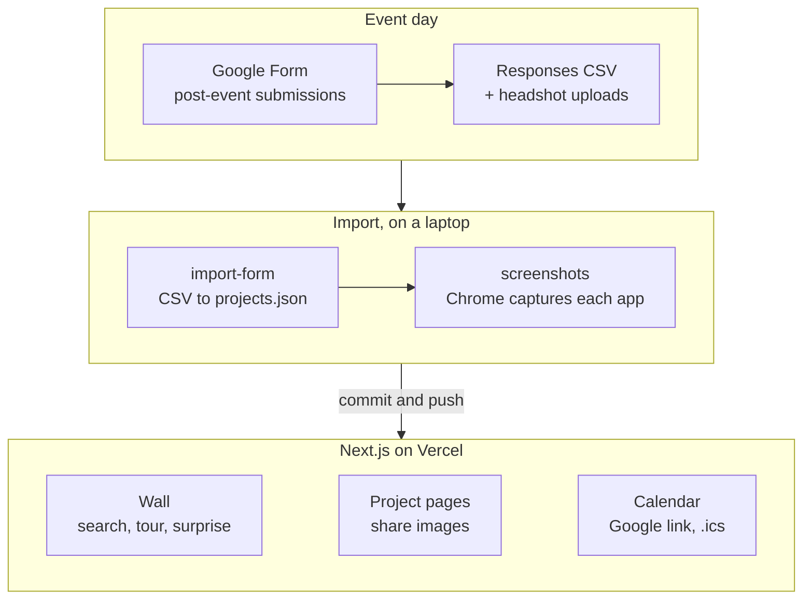

<p align="center"></p>

# Disruption Lab × Replit Learnathon

**The event site and project wall for a beginner AI build day at UIUC.** Before the event it gets students signed up; afterwards it becomes a public wall of every app they shipped with Replit.

**[Visit → learnathon.bhanusadhu.com](https://learnathon.bhanusadhu.com)** · Saturday, Nov 7, 2026, CIF Monumental Steps.


## The problem

Most students have heard you can build an app with AI, but few have shipped one, and a club workshop usually ends with half-finished projects on laptops that nobody sees again. The Disruption Lab at Gies and Replit wanted an afternoon where anyone, with no coding experience, leaves with a live app. Every one of those apps should then have somewhere public to live.

The goal: **turn interest into sign-ups before Nov 7, and turn every app shipped that day into a link on the wall.**

## How it works

1. **Get interested.** The hero states the promise (one afternoon, zero experience, a live app) and counts down to build day. The details card has the time, place, calendar links and directions.
2. **Sign up.** Three forms in order: an interest form open to anyone, a pre-event form required to attend, and a post-event form required to get on the wall.
3. **Build.** On the day, students build with Replit and publish their app.
4. **Land on the wall.** Submissions are imported into the site, each live app is screenshotted, and the build gets a card, its own share page and, for winners, an award ribbon.
5. **Browse.** Search the wall, let tour mode cycle through builds every 8 seconds on a big screen, or hit Surprise me.

<p align="center"></p>

## Product decisions

| Decision | Trade-off |
| --- | --- |
| **A static site fed by one JSON file, no database** | Updating the wall means importing and redeploying. In return there is nothing to log into and nothing to break on event day, and hosting is free. |
| **Google Forms for sign-ups and submissions** | Exports are manual CSV downloads. But organizers already run forms there, students trust them, and uploads like headshots come for free. |
| **The wall is live before the event, with reserved slots** | An empty wall looks bare. Showing "Your build here" slots makes the promise concrete, and each slot links to sign-up. |
| **No form, no spot on the wall** | Some builds won't appear. The post-event form is how a student consents to being shown and gives the right link. |
| **One config for the event** | Date, time, place, links and FAQ live in one file, so a change to the domain or time updates the page, the link previews and the calendar files together. |
| **Built for a projector too** | Tour mode and Surprise me add code. But the wall gets shown on a screen during the event, so it needed to play by itself. |

## Architecture



Every page, including one per project, is generated at build time from `data/event.ts` and `data/projects.json`. → [`data/event.ts`](data/event.ts), [`lib/projects.ts`](lib/projects.ts)

## Hard problems

**A form becomes a wall without a backend.** The importer turns the responses CSV into `projects.json` and matches headshot uploads back to their rows by the file names Google Forms gives them ("photo - Respondent Name.jpg"). Re-running it is safe: fields set by hand, like a winner's award and the screenshot path, are kept by slug, so organizers can import, pick winners and import again. → [`scripts/import-form.mjs`](scripts/import-form.mjs)

**A screenshot of every live app.** Each card needs a picture of the app itself, not a logo. A script opens every submitted Replit link in the installed Chrome, captures it, and records the path. By default it only shoots projects that don't have one yet, and it can redo everything or a chosen few. → [`scripts/screenshots.mjs`](scripts/screenshots.mjs)

**Links that look right when shared.** Every build has its own static page with a generated preview image, so a student's link shows their project in a group chat, not the event. The event's own preview image uses the same type and optical alignment as the headline, and the calendar invite and Google Calendar link are generated from the same event config. → [`app/p/[slug]`](app/p/%5Bslug%5D)

## Results

The event hasn't happened yet, so there are no outcomes to report. What it will be judged on is the funnel the site is built around:

| Step | Counted from |
| --- | --- |
| Interested | Interest form responses |
| Signed up | Pre-event form responses |
| Shipped | Post-event form submissions |
| On the wall | Projects in `data/projects.json` |

Checked so far: the site builds statically, with a page per project. An accessibility and craft pass from a design audit covered contrast, focus and motion. Smooth scrolling and reveal animations respect reduced-motion settings.

## How it was built

1. **The wall first.** A project data model, the event config, and a wall of project cards with empty slots in UIUC branding.
2. **The pipeline.** The Google Form importer and the automatic screenshot script.
3. **The event page.** Event guide, countdown, form links, calendar files, FAQ and Disruption Lab socials.
4. **Identity.** The Illinois palette (Illini blue, orange accents), the Block I icon, and a headline tuned until it matched the link preview.
5. **Browsing.** Wall search, tour mode, Surprise me and per-project share pages, then an accessibility and craft pass.

## Tech stack

| Layer | Technology |
| --- | --- |
| Site | Next.js (App Router, static generation), React, TypeScript, Tailwind CSS |
| Type and motion | Geist Sans and Mono, Lenis smooth scrolling |
| Data | `data/event.ts`, `data/projects.json` from Google Forms |
| Tooling | Node scripts, `playwright-core` with the installed Chrome |
| Hosting | Vercel |

## Run it locally

```bash
npm install
npm run dev                                               # http://localhost:3000
npm run import-form -- form-data/responses.csv --uploads form-data/uploads
npm run screenshots                                       # capture apps missing a screenshot
npm run build                                             # static build, one page per project
```

Event details live in `data/event.ts`. Pushes to `main` deploy on Vercel.

## Project structure

```
app/            # The page, per-project pages, preview images, calendar file
components/     # Wall browser, tour, project card, event guide, terminal hero
data/           # Event config and projects.json
lib/            # Project loading, calendar links, preview image helpers
scripts/        # Form importer and screenshot capture
public/         # Brand assets, headshots, project screenshots
```

## What's next

Known limits:
- The itinerary, prizes and food are still "TBA" until the organizers confirm them.
- Updating the wall needs a local import and a redeploy, so builds appear in batches, not live.

Next: open the pre- and post-event forms, import the submissions after Nov 7, mark the winners, and report the funnel counts here.
