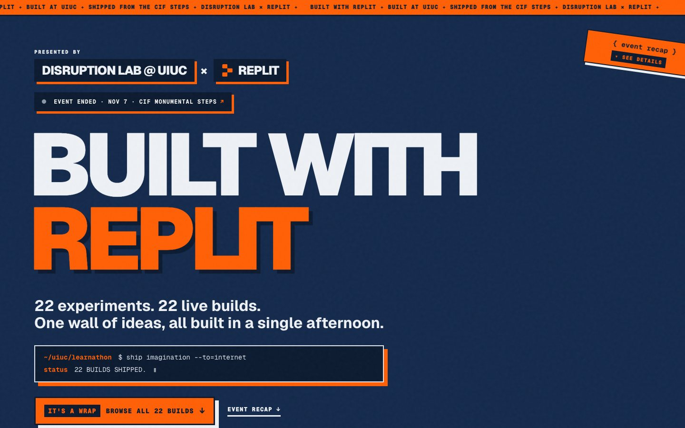
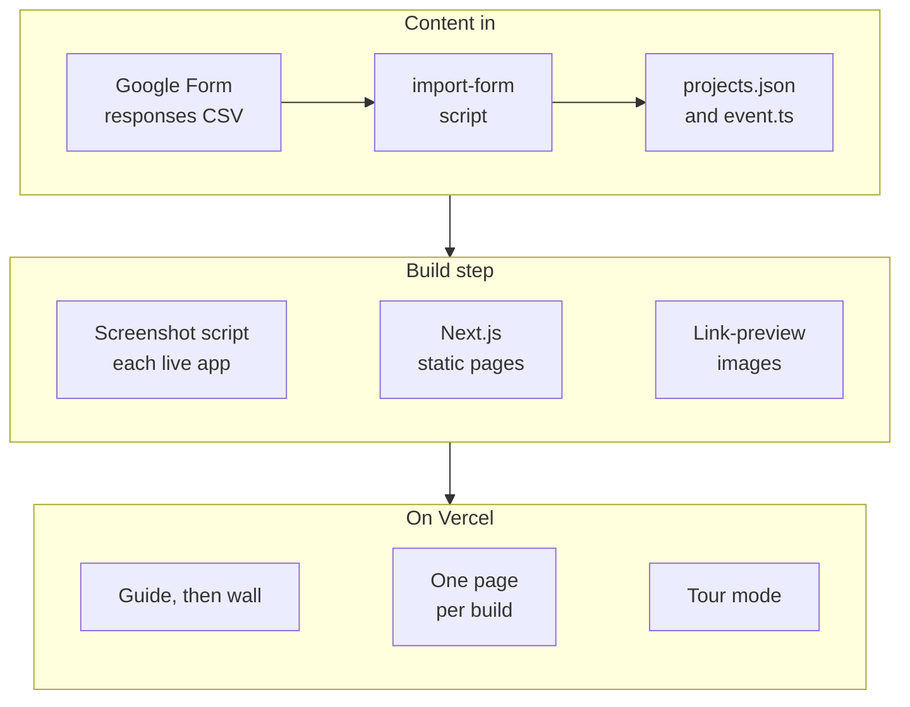

# Replit Learnathon

**The event site for a beginner build day at UIUC: a sign-up guide before the event and a wall of every student's live app after it.** Disruption Lab at UIUC and Replit ran the day on Nov 7, and 22 builds shipped.

**[See the wall → learnathon.bhanusadhu.com](https://learnathon.bhanusadhu.com)** · a static site, no sign-up



## The problem

A student build day produces dozens of small projects in one afternoon, and then the work disappears into a spreadsheet of links. Before the event, organizers need one place for the steps attendees must take, the schedule and the prizes. After it, they need a way to show what was made, give each builder a link to share, and put the best builds on a projector.

The goal was **one site that serves both moments from a single repository.**

## How it works

1. **Before the event.** The home page is a guide: three numbered steps (RSVP, a pre-event form and a post-event form), the schedule, perks, a countdown, an add-to-calendar link for Google Calendar or an `.ics` file, and a short FAQ.
2. **At the event.** Builders submit a Replit link, a one-line description and a headshot through a Google Form.
3. **Import.** One command turns the form's CSV into the wall's data, and another captures a screenshot of every live app.
4. **After the event.** The site flips to a recap: a wall of cards with search, an award ribbon on each winner, and a prize list that links straight to the winning card.
5. **Share and present.** Every build has its own page with its own link preview, and a tour mode steps through the builds one at a time on a projector.

## Product decisions

| Decision | Trade-off |
| --- | --- |
| **No backend and no database** | The site is static, fast and free to host, and there is nothing to break on the day. Content is edited in two files, so only the owner can change it. |
| **One site for before and after** | Attendees keep a single link from invitation to recap. The cost is more states to design and test than two separate pages. |
| **A Google Form for submissions** | Builders already know it, and nothing needs building. The CSV holds emails, so it stays out of Git and an importer does the conversion. |
| **A page and a link preview per build** | Each builder can share their own app, which is the point of a wall. It adds 22 generated pages and a preview image. |
| **Tour mode for the projector** | Awards and demos need a big-screen view that runs itself, at the cost of a timer that must respect reduced-motion settings. |
| **Awards live in data, not in code paths** | Setting a winner is a one-line edit that survives re-importing the form. There is no admin screen. |

## Architecture



`data/event.ts` holds the schedule, forms, prizes and the end time. `data/projects.json` holds the builds. The home page reads both and renders the guide or the recap, and `app/p/[slug]` is generated once per build.

## Hard problems

**Turning a form export into a clean wall.** Google Forms exports quoted fields, escaped quotes and newlines inside cells, and names uploaded headshots `"<original name> - <Respondent Name>"`. [scripts/import-form.mjs](scripts/import-form.mjs) has its own RFC 4180 CSV parser and matches uploads back to rows by that name. Re-running it is safe: awards and screenshots already in `projects.json` are kept by slug, so a winner can be set and the form imported again.

**Screenshots of 22 apps we do not control.** [scripts/screenshots.mjs](scripts/screenshots.mjs) opens each submitted Replit app in the installed Chrome and saves a card image, only for builds that do not have one yet, or for named slugs, so a re-run is cheap.

**Share cards for every build.** Each build page sets its own title, description and Open Graph image, and the preview image is drawn with the site's own Geist Black font in [lib/og.ts](lib/og.ts), so a shared link looks like the site, not a generic card.

**A projector mode that runs by itself.** The tour advances every 8 seconds, and the progress bar's CSS animation is the timer, so pausing the animation pauses the tour and its end advances it. Arrow keys step through builds, and visitors who prefer reduced motion get a manual slideshow. See [components/Tour.tsx](components/Tour.tsx).

## Results

Measured on the live site with Lighthouse, mobile preset, on 2026-11-12:

- **Accessibility 100, Best Practices 100, SEO 100, Performance 95.**
- **Largest Contentful Paint 3.0 s**, First Contentful Paint 1.0 s, **Total Blocking Time 10 ms** and **Cumulative Layout Shift 0**.
- **22 builds shipped in one afternoon,** with six category awards and three honorable mentions recorded in the site's data.

**Not measured:** attendance, how many people visited the wall, and any automated tests. The repository has no test suite.

## How it was built

- **Scaffold and wall.** A Next.js app with Tailwind, a project data model and event config, and the wall's card styles adapted to UIUC colors.
- **Intake.** A Google Form importer and a screenshot script, then documentation of the form setup and the winners flow.
- **Brand and copy.** Many small passes on the headline, the link preview and the favicon until the wall read as the event's own.
- **The guide.** Countdown, form links, add-to-calendar, FAQ and socials, then load-in and scroll animations.
- **Recap.** The site flips from invitation to recap, with search, awards, per-build pages, tour mode and smooth scrolling.

## Tech stack

| Layer | Technology |
| --- | --- |
| Framework | Next.js 16 App Router, React 19, TypeScript |
| Styling | Tailwind 4, Geist and Geist Mono, Lenis smooth scrolling |
| Content | Two data files, a Google Form, import and screenshot scripts, `playwright-core` |
| Hosting | Vercel |

## Run it locally

```bash
npm install
npm run dev                                       # http://localhost:3000
npm run import-form -- form-data/responses.csv    # build projects.json from a Google Form CSV
npm run screenshots                               # screenshot builds that have none yet
npm run build                                     # static build
```

Edit `data/event.ts` for the date, forms, schedule and prizes, and set a project's `award` in `data/projects.json`. Raw form exports live in `form-data/`, which is ignored because it contains email addresses.

## Project structure

```text
app/              home page, one page per build (p/[slug]), link-preview image, calendar file
components/       wall, tour, stage, event guide, promo, terminal
data/             event.ts (schedule, forms, prizes) and projects.json
lib/              project helpers, calendar links, link-preview drawing
scripts/          form importer and screenshot script
public/           headshots, project screenshots and brand marks
```

## What's next

**Known limits**

- The before-and-after switch uses the date at build time, so the site shows the recap after its first deploy past the event end.
- Content is edited in files, so there is no admin screen and no submissions from the site itself.
- No automated tests, and no analytics.

**Next:** a small test for the importer and the date switch, and a template so the next Disruption Lab event can reuse the site.
