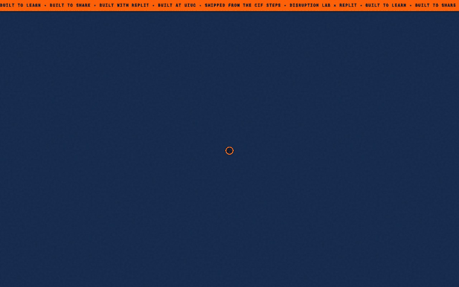
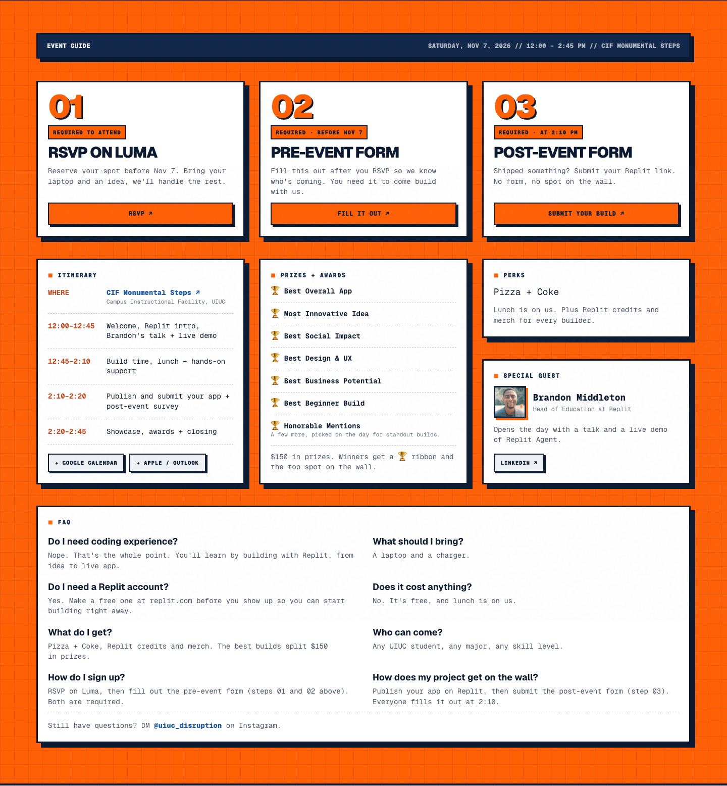
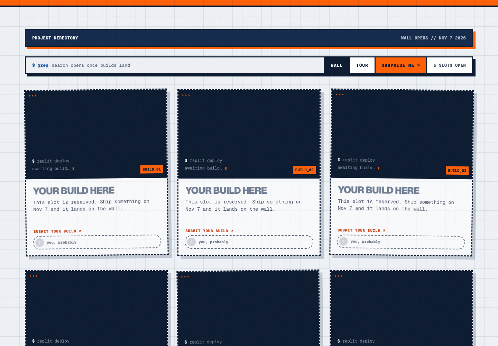
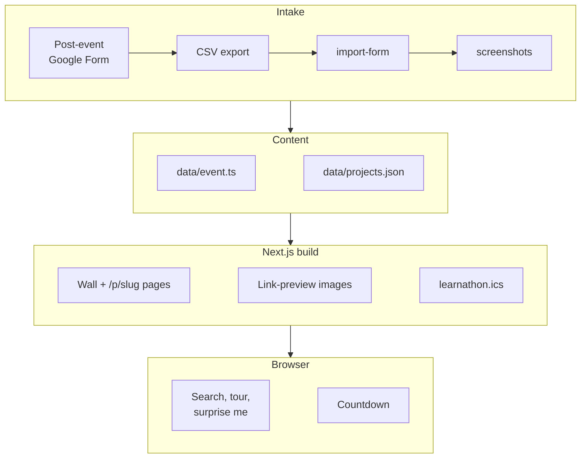

# UIUC Learnathon

**The event site for Disruption Lab × Replit's build day at UIUC: sign-up steps, schedule and awards before the event, a wall of every attendee's live app after it.**

**[Try it → learnathon.bhanusadhu.com](https://learnathon.bhanusadhu.com)** (free, no sign-in)



## The problem

A three-hour build day for beginners produces a pile of Replit apps and nowhere to put them. The apps end up as links in a group chat, the organizers need a sign-up flow and a schedule in the meantime, and attendees who built something have no single page to share.

The goal: **every attendee who builds ends the day with a live app on one public wall, and a link they can send to anyone.**

## How it works

1. **RSVP** on Luma. This is the headcount and is required to attend.
2. **Pre-event form** (Google Form). Required, so the organizers know who is coming.
3. **Build** with Replit at the CIF Monumental Steps, 12:45 to 2:10 PM, after a talk and live demo from Replit's Head of Education.
4. **Submit your Replit link** in the post-event form at 2:10. No form, no spot on the wall.
5. **Showcase**: the organizers import the responses, and the wall fills with one card per build. Winners get a ribbon and the top spots.



## Product decisions

| Decision | Trade-off |
| --- | --- |
| **No database: content lives in two files and git** (`data/event.ts`, `data/projects.json`) | Updating the site means editing a file and pushing, not clicking in an admin panel. In return there is no backend to fail on event day, the whole site is static, and hosting costs $0. |
| **Submissions go through a Google Form, not an in-app form** | An organizer runs one import command per batch instead of builds appearing live. In return there is no auth, no spam surface and no moderation queue to build. |
| **Three required steps (RSVP, pre-form, post-form)** | More friction than one sign-up. The cost buys a headcount before the day and a Replit link from every attendee at 2:10, which is what fills the wall. |
| **The wall opens before the event with 6 reserved slots** | A "your build here" placeholder is less honest than hiding the wall, but an empty page would not show what attendees are building toward. Search stays off until real builds exist. |
| **Tour mode for the projector** | Auto-advances every 8 seconds with pause and arrow keys. It is built for the awards showcase, so the grid stays the default on phones. |
| **Several winners can share "Honorable Mention"** | The award string is `Honorable Mention: <reason>`, so reasons can be decided on the day without a code change. Winners are listed in a dropdown in the guide. |



## Architecture



Everything is prerendered at build time (7 routes, no server code at runtime). `import-form` and `screenshots` run on an organizer's laptop; Vercel rebuilds on every push to `main`. The only client-side state is the wall's search, view mode and the countdown.

## Hard problems

**One source of truth for a page that changes state.** The site has to work as an invite before the event and a showcase after it, and every date, link and prize shows up in several places (hero, popover, guide, FAQ, calendar, link preview). All of it reads from [data/event.ts](data/event.ts). The Google Calendar link and the `.ics` file in [lib/calendar.ts](lib/calendar.ts) are generated from the same start and end timestamps, with RFC 5545 escaping and 75-octet line folding. The page title, link preview and hero copy switch on `projects.length`, so importing the first build flips the site from invite to showcase with no other change.

**An importer that is safe to re-run.** Form exports are messy: quoted fields, newlines inside answers, duplicate submissions, and headshot uploads that Google names `<original name> - <Respondent Name>.jpg`. [scripts/import-form.mjs](scripts/import-form.mjs) has its own RFC 4180 parser, matches columns by header pattern, keeps the latest submission per project title, and matches uploads back to rows by respondent name. Re-running keeps `award` and `screenshot` fields already in `projects.json` (matched by slug), so organizers can import, set winners and import again. It reports unmatched columns and skipped rows instead of guessing.

**Smooth scroll, scroll reveals and React fighting each other.** Combining Lenis, in-page anchors and React re-renders caused three problems, each fixed with a comment in the code:
- Lenis's own `anchors` option does not cancel the browser's native jump, so the two animated against each other. [SmoothScroll.tsx](components/SmoothScroll.tsx) handles `#` links itself.
- React rewrites `className` on re-render and would drop the "revealed" class and hide cards that had already animated in. [Reveal.tsx](components/Reveal.tsx) marks revealed elements with a `data-in` attribute.
- Award links in the guide have to open a card in the wall, even from tour view or a filtered search. [WallBrowser.tsx](components/WallBrowser.tsx) listens in the capture phase so it runs before the scroll handler, clears search and switches back to the grid first.

Users who prefer reduced motion get plain scrolling, no reveals and a tour that does not auto-advance.

## Results

| Check | Result | What it means |
| --- | --- | --- |
| Lighthouse, desktop (live site) | **100 / 100 / 100 / 100** | Performance, accessibility, best practices, SEO. LCP **0.6 s**, CLS **0**. |
| Lighthouse, mobile (live site) | **94 / 100 / 100 / 100** | Same four categories. LCP **3.0 s**, CLS **0**, TBT **10 ms**. |
| `tsc --noEmit` | **0 errors** | The whole app is strict TypeScript. |
| `next build` | **7 routes**, all static | No runtime server code to fail. |

Scores come from Lighthouse 12 run against the production URL with its default throttling.

**Not measured yet:** there are no automated tests in this repo, so the importer and the award matching are checked by hand. There is no real-user data, since the event had not happened when this was written. Whether attendees actually submit a build, and how many, is the number that decides if the site worked.

## How it was built

1. **Wall first.** Scaffolded Next.js and Tailwind, defined the project data model, and built the card wall with reserved empty slots.
2. **Import pipeline.** Wrote the Google Form CSV importer and a script that screenshots each submitted Replit app, so organizers never hand-edit the wall.
3. **Event guide.** Added the countdown, FAQ, calendar links and the form steps, then moved the site to its own subdomain.
4. **Brand and link previews.** Rebuilt the look in the Illinois palette after the first version sat too close to its reference, and made the link-preview image match the headline.
5. **Wall tools.** Added search, tour mode, Surprise Me and a shareable page per build, plus the Lenis smooth-scroll and reveal motion.
6. **Event-week details.** Swapped the interest form for a Luma RSVP, then added the itinerary, award categories with honorable mentions, perks and the guest card.

## Tech stack

| Layer | Technology |
| --- | --- |
| Frontend | Next.js 16 (App Router), React 19, TypeScript, Tailwind CSS 4, Geist fonts, Lenis |
| Data | `data/event.ts` and `data/projects.json`, committed to git |
| Scripts | Node: CSV importer, Playwright-based screenshot capture (uses installed Chrome) |
| Link previews | `next/og` image routes for the site and for each build |
| Hosting | **$0**: Vercel Hobby, deployed on push to `main` |

## Run it locally

```bash
npm install
npm run dev                  # http://localhost:3000
npx tsc --noEmit             # typecheck
npm run build                # production build, must pass before pushing

# After the event: turn the post-event form into the wall
npm run import-form -- form-data/responses.csv --uploads form-data/uploads
npm run screenshots          # capture each live app (add --all to redo every one)
```

No environment variables are needed. `form-data/` is git-ignored because the raw export contains emails.

## Project structure

```
app/
  page.tsx                  # hero, guide and wall in one page
  p/[slug]/                 # one shareable page + link preview per build
  learnathon.ics/           # calendar download
components/
  WallBrowser.tsx           # search, wall/tour toggle, Surprise Me, deep links
  Tour.tsx                  # auto-advancing projector view
  EventGuide.tsx            # steps, itinerary, prizes, perks, guest, FAQ
data/
  event.ts                  # every date, link, prize and FAQ answer
  projects.json             # the builds (written by import-form)
lib/                        # calendar + .ics, award matching, shared types
scripts/                    # import-form.mjs, screenshots.mjs
docs/images/                # README screenshots and demo
```

## What's next

**Known limits**
- Mobile LCP is **3.0 s**; I have not traced which element it is or fixed it.
- No automated tests. The importer is the riskiest code and is only exercised by hand.
- A build only appears after an organizer runs the import and pushes, so the wall is not live during the event.
- Screenshots of builds are captured once. A Replit app that changes later keeps its old image.

**Next**
- After the event, record submission rate (post-form responses out of RSVPs) and how many builds were live, and put those numbers here.
- Add a fixture CSV and a test that the importer keeps awards across a re-import.
- Trace and fix the mobile LCP.
