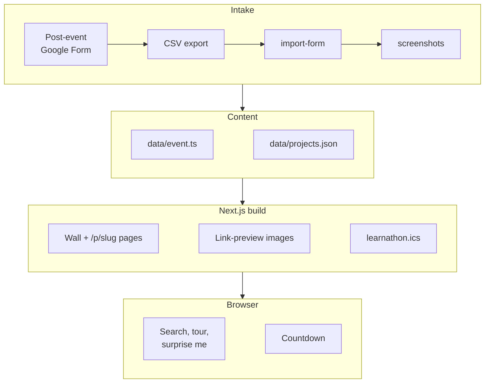

# Replit Learnathon

**The event site for Disruption Lab × Replit's build day at UIUC: sign-up steps, schedule and awards before the event, and one wall of 22 live student apps after it.**

**[Try it → learnathon.bhanusadhu.com](https://learnathon.bhanusadhu.com)** (free, no sign-in). **The event is over (Nov 7):** the guide now reads as a recap and the wall is the main page.


## The problem

A three-hour build day for beginners produces a pile of Replit apps and nowhere to put them. The apps end up as links in a group chat, organizers need a sign-up flow and a schedule in the meantime, and the students who built something have no single page to send to a friend or a recruiter.

**The goal: every attendee who builds ends the day with a live app on one public wall, and a link they can share.**

It worked: the post-event form got 26 responses from 24 people, and **22 unique builds** are on the wall, **9 of them with awards**.

## How it works

1. **RSVP and pre-event form.** The guide walks attendees through Luma, then a Google Form. Both are required, so organizers get a headcount before the day.
2. **Build and publish.** Attendees build with Replit and publish the app to a public `.replit.app` link.
3. **Submit at 2:10.** The post-event form collects name, project, Replit link, a one-line description, LinkedIn and a headshot. No form, no spot on the wall.
4. **Import.** An organizer exports the responses as CSV, runs `npm run import-form`, then `npm run screenshots`, sets winners in `data/projects.json` and pushes. Vercel redeploys.
5. **Browse.** The wall has search, a tour mode for the projector and Surprise Me. Every build also has a shareable page at `/p/<slug>` with its own link preview.


## Product decisions

| Decision | Trade-off |
| --- | --- |
| **No database: content lives in two files and git** (`data/event.ts`, `data/projects.json`) | Updating the site means editing a file and pushing, not clicking in an admin panel. In return there is no backend to fail on event day and every page is static. |
| **Submissions go through a Google Form, not an in-app form** | An organizer runs one import command per batch, so builds do not appear live. In return there is no auth, no spam surface and no moderation queue to build. |
| **Three required steps (RSVP, pre-form, post-form)** | More friction than one sign-up. It buys a headcount before the day and a Replit link from every attendee at 2:10, which is what fills the wall. |
| **The wall opened before the event with 6 reserved slots** | A "your build here" placeholder is less honest than hiding the wall, but an empty page would not show attendees what they were building toward. Search stayed off until real builds existed. |
| **Tour mode for the projector** | It advances every 8 seconds with pause and arrow keys. It was built for the awards showcase, so the grid stays the default on phones. |
| **Winners are a string on the project, not a table** | `"Best Design & UX"` or `"Honorable Mention: <reason>"`. Several builds can share a prize and reasons can be decided on the day, but a typo silently drops the build from the guide's prize list and the top spots. |


## Architecture



Everything is prerendered at build time: 51 static pages and no server code at runtime. `import-form` and `screenshots` run on an organizer's laptop, and Vercel rebuilds on every push to `main`. The only client-side state is the wall's search, view mode and the countdown.

## Hard problems

**Form exports are messy, and the importer has to be safe to re-run.** Google's CSV has quoted fields, newlines inside answers, duplicate submissions and headshot uploads named `<original name> - <Respondent Name>.jpg`. [scripts/import-form.mjs](scripts/import-form.mjs) has its own RFC 4180 parser, matches columns by header pattern, keeps one row per project title and matches uploads to rows by respondent name. Re-running keeps `award` and `screenshot` values already in `projects.json`, so organizers can import, set winners and import again. On the real export it turned 26 rows into 22 builds: 2 rows had no project and 2 were re-submissions.

**22 headshots at up to 18 MB each, shown in a 43px circle.** The sheet only held Drive links, so the photos were downloaded from Drive through a logged-in browser. The largest original was 18.3 MB, and a plain center crop of a tall portrait showed the torso instead of the face. Apple's Vision framework found exactly one face in each of the 22 photos, each photo was cropped to a square centered on that face and resized to 256px, and the whole folder came to **288 KB**. Cards are styled in [ProjectCard.tsx](components/ProjectCard.tsx) and the images live in [public/avatars](public/avatars).

**One source of truth for a page that changes state.** The site has to work as an invite before the event and a showcase after it, and every date, link and prize shows up in several places. All of it reads from [data/event.ts](data/event.ts). The Google Calendar link and the `.ics` download in [lib/calendar.ts](lib/calendar.ts) come from the same start and end timestamps, with RFC 5545 escaping and 75-octet line folding. The hero copy, wall header, footer and page title switch on `projects.length`, so importing the first build flipped the site from invite to showcase with no other change. A second flag, `eventOver` (true once `event.end` has passed), turns the rest into a recap: the status line says the event ended, the RSVP button becomes a link to the wall, the three sign-up steps are marked closed, and the calendar buttons and directions link are hidden.

**Smooth scroll, scroll reveals and React fighting each other.** Three bugs, each fixed with a comment in the code:
- Lenis's own `anchors` option does not cancel the browser's native jump, so the two animated against each other. [SmoothScroll.tsx](components/SmoothScroll.tsx) handles `#` links itself.
- React rewrites `className` on re-render and dropped the "revealed" class, hiding cards that had already animated in. [Reveal.tsx](components/Reveal.tsx) marks them with a `data-in` attribute instead.
- Award links in the guide have to open a card in the wall, even from tour view or a filtered search. [WallBrowser.tsx](components/WallBrowser.tsx) listens in the capture phase so it runs before the scroll handler, clears search and switches back to the grid first.

Users who prefer reduced motion get plain scrolling, no reveals and a tour that does not auto-advance.

## Results

| Check | Result | What it means |
| --- | --- | --- |
| Builds on the wall | **22** from 26 responses (24 people) | Every attendee who submitted a Replit link got a card. 2 respondents submitted no build. |
| Awards | **9** (6 prizes and 3 honorable mentions) | Winners get a ribbon and the top spots on the wall, and the guide links to each. |
| Headshots, screenshots | **22 / 22**, **22 / 22** | Every card has a photo and a screenshot of the live app. |
| Lighthouse, desktop (live site) | **100 / 100 / 100 / 100** | Performance, accessibility, best practices, SEO. LCP **0.3 s**, CLS **0**. |
| Lighthouse, mobile (live site) | **100 / 100 / 100 / 100** | Same four categories. LCP **1.0 s**, CLS **0**, TBT **10 ms**. |
| `tsc --noEmit` | **0 errors** | The whole app is strict TypeScript. |
| `next build` | **51 static pages** | No runtime server code to fail. |

**Post-event survey (26 responses, 1 to 5):** "I could use AI to turn an idea into a working prototype" averaged **4.46**, with all 26 at 4 or 5. "I could fix an error by describing the problem to AI" averaged **4.23**. "I would be able to spot an error in AI's output" averaged **3.81**, the weakest of the three. "Not knowing where to start would hold me back" averaged **2.65**.

**Not measured:** the survey was asked after the event only, so there is no baseline and it cannot show that confidence improved. RSVP and attendance counts live in Luma, not in this repo, so there is no RSVP-to-submission rate. There are no automated tests: the importer and the award matching were checked by hand against the real export.

## How it was built

1. **Wall first.** Scaffolded Next.js and Tailwind, defined the project data model and built the card wall with reserved empty slots.
2. **Import pipeline.** Wrote the Google Form CSV importer and a script that screenshots each submitted Replit app, so organizers never hand-edit the wall.
3. **Branding churn.** The headline lockup, link preview and colors were redone several times. The palette moved to Illini blue and orange once the first one sat too close to the design that inspired it.
4. **Event guide.** Added the countdown, Google Calendar and `.ics` buttons, FAQ, itinerary, perks, the guest card, Luma RSVP and the pre and post forms.
5. **Wall features.** Added search, tour mode, Surprise Me, per-build share pages with their own link previews, and Lenis smooth scrolling.
6. **Event day and after.** Set the awards, imported the 22 builds, took the screenshots and added the headshots. The first headshot crops were center-based and cut off faces, so they were redone around detected faces. The site was then marked as ended: the guide became a recap and the sign-up buttons were retired.

## Tech stack

| Layer | Technology |
| --- | --- |
| Frontend | Next.js 16 (App Router), React 19, TypeScript, Tailwind CSS 4, Geist fonts, Lenis |
| Content | Two typed files and a JSON file in git, no database |
| Import and capture | Node scripts, `playwright-core` driving the installed Chrome for screenshots |
| Hosting | Vercel, deployed from `main`, on a `bhanusadhu.com` subdomain |

## Run it locally

```bash
npm install
npm run dev                                   # http://localhost:3000
npm run build                                 # typechecks and prerenders all 51 pages
npm run import-form -- form-data/responses.csv [--uploads form-data/uploads]
npm run screenshots                           # only builds missing a screenshot; --all redoes every one
```

There are no environment variables. Vercel deploys on every push to `main`. `form-data/` is gitignored because the raw export contains email addresses.

## Project structure

```
data/event.ts        every date, link, prize and FAQ line on the site
data/projects.json   the wall: one entry per build, plus its award
app/                 home page, /p/[slug] share pages, link-preview images, learnathon.ics
components/          wall, tour, event guide, cards, scroll and reveal helpers
lib/                 calendar link and .ics generator, award matching, shared types
scripts/             import-form (CSV to JSON) and screenshots (live apps to PNG)
public/              avatars (288 KB), project-shots (13 MB), guest photo, brand assets
docs/images/         the screenshots and demo GIF in this README
```

## What's next

**Known limits**
- The headshot resize and face-centered crop ran as a one-off script and is not in the repo. `import-form` copies uploads as they are.
- The importer keeps the latest submission per title. For one attendee that picked a draft preview URL over the published one, and it was fixed by hand in the CSV.
- Screenshots are taken once. If a student unpublishes or changes an app, the card still shows the old screenshot, and nothing checks that links stay live.
- Three Honorable Mention builds have no stated reason, so their cards show the award alone.
- One headshot carries a photographer's watermark. It is faint at 43px, but swapping the photo is the only fix.
- `public/project-shots` is 13 MB of PNGs in git, which will slow clones as the wall grows.

**Next**
- Commit the headshot crop as a `scripts/` step and make the importer warn when a re-submission looks like a draft URL.
- Add a link checker that flags builds whose Replit app has gone offline.
- Ask the survey before and after next time, so the confidence numbers can show change.
